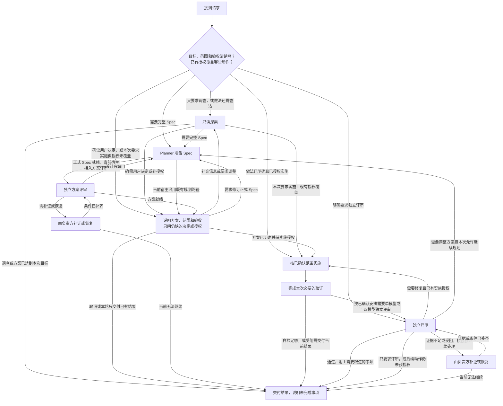
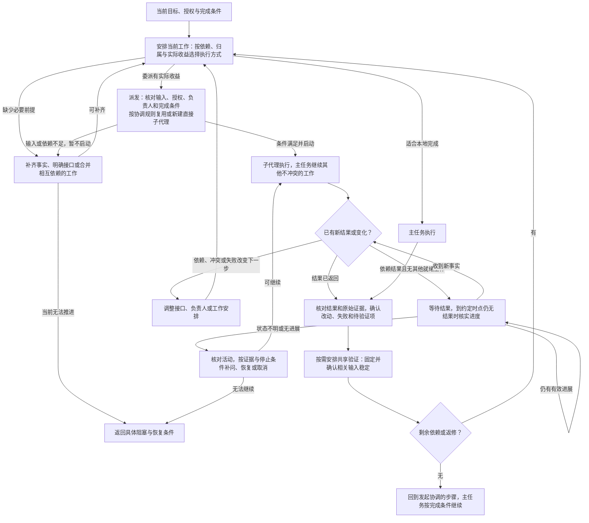
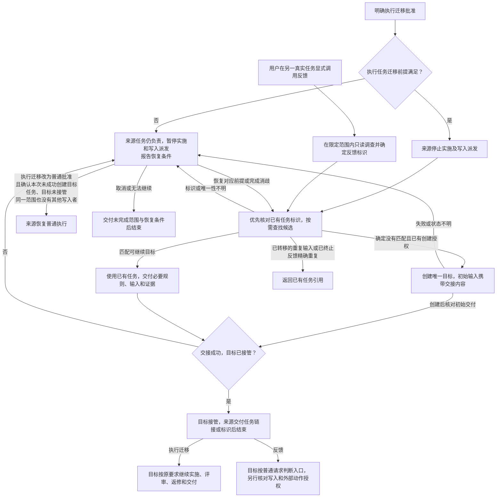

# Sacha Orchestra 插件顶层设计

> 文档身份：插件开发使用；不进入发布插件。

本文供插件开发者、评审者和代理查阅，与仓库根 `AGENTS.md` 并列。本文说明插件入口、工作流程、角色和技能的职责，以及各项规则由哪个文件负责。工具调用细节见各运行环境的适配器。

开发文档的术语见[项目上下文](docs/CONTEXT.md)。多个发布组件共用的术语由[术语定义](plugins/sacha-orchestra/core/terminology-contract.md)集中维护。项目上下文记录定义链接、使用方和核验方法，也收录仅供开发、维护和评审使用的术语。

## 根本准则

以下准则约束本设计及其细化规则，用于开发和评审时判断规则是否必要、职责是否一致。运行时判断仍由第 1 节的负责文件定义；发现不一致时修正对应规则，不由执行者据此另造流程或跳过既有条件。

工作流决定谁负责、工作有何依赖、何时派发及谁接收结果。只有需要时才进入规划、协调或独立评审。各项检查随派发、写入或交付完成，已确认的选择、范围、授权和方案直接沿用。相关事实变化或恢复资料不足时，只补查受影响的部分。

1. **授权与责任明确。** 任务沿已确认的目标、范围和授权推进；每项工作及其交接必须有明确负责方。角色调用、工具可用或上下文转移不扩大授权。
2. **方案写到能实施。** 用代表性输入和主要使用过程说明需求、设计和验收。需要实施规格（Spec）时，规划者写清修改位置、会影响实施的接口和数据关系、实施步骤及可观察的验收结果。执行者按[工作记录规则](plugins/sacha-orchestra/core/artifact-protocol.md#21-spec-artifact)自行处理并验证局部出入。发现必要设计缺失，或需要改变已批准的约束时，交回主任务。
3. **每项判断由一个文件负责。** 核心规则规定各运行环境共用的判断。技能说明各自职责内的做法。适配器说明怎样调用运行环境的工具。其他地方保留引用与本处必要的说明。
4. **复杂度必须有当前依据。** 优先通过现有实现的局部修改满足目标；新增抽象、防御、兼容、回退或流程机制，必须说明当前需求或真实失败为何无法由现有做法满足。必要设计足以落实目标后停止扩展，不为假想边界补机制。按已有条件判断是否启动各步骤，委派按独立性和实际收益选择；不能用成本判断代替启动条件，也不为派发人为拆分工作。
5. **只读当前工作所需的规则，只保存后续用得上的信息。** 根据下一步要判断、实施、验收或恢复的内容决定读什么、记什么。使用方依赖的格式和入口继续保留。
6. **结论有证据，阻塞有边界。** 结论只覆盖直接证据能够证明的范围，复用仍有效的验证。缺少条件时停止受影响部分，并继续独立且已授权的工作。保持独立评审和单一写入者，按协调规则执行中断、核实停写和接管。

## 1. 各项规则与负责文件

| 文件或组件 | 负责内容 | 由其他文件规定的内容 |
| --- | --- | --- |
| [入口规则](plugins/sacha-orchestra/core/intake-contract.md) | 判断当前请求的工作方式、已有授权和确实需要补齐的决定 | 工作流、评审、协调、工具调用 |
| [术语定义](plugins/sacha-orchestra/core/terminology-contract.md) | 多个发布组件共用、且不限于某一运行环境的术语及其适用范围 | 开发专用术语、流程、用户交互、协调、工作记录和工具调用 |
| [工作流规则](plugins/sacha-orchestra/core/workflow-contract.md) | 插件工作流程、角色职责、步骤何时开始或结束、如何根据用户决定继续 | 派发条件、评审证据、工作记录、模型参数 |
| [交互规则](plugins/sacha-orchestra/core/human-interaction-contract.md) | 向用户提问、报告进度和交付结果的方式 | 流程、授权判断、角色做法、工具参数 |
| [验收规则](plugins/sacha-orchestra/core/assurance-contract.md) | 验收基线、由谁执行验收或提供条件、评审结论与复评 | 何时启动独立评审、实施方法、工具调用 |
| [协调规则](plugins/sacha-orchestra/core/coordination-contract.md) | 怎样拆分和安排工作、判断何时派发和等待、只保留一个写入者、移交责任和避免重复处理 | 何时启动协调、角色职责、模型和工具参数 |
| [工作记录规则](plugins/sacha-orchestra/core/artifact-protocol.md) | 何时记、最少记什么、如何标记 Spec 完成、采用什么依据及如何恢复 | 流程、保存路径、项目原始事实和共享术语的定义 |
| [Codex 适配器](plugins/sacha-orchestra/adapters/codex/runtime-adapter.md) / [Claude Code 适配器](plugins/sacha-orchestra/adapters/claudecode/runtime-adapter.md) / [DeepSeek Harness 适配器](plugins/sacha-orchestra/adapters/dsh/runtime-adapter.md) | 各运行环境的工具调用、参数、回退、恢复、按需记录和取证方法 | 启动条件、工作能否开始、角色职责、通用流程和评审裁决 |
| [DSH 配套包](integrations/dsh/sacha-companion) | 为一个 DSH 配置管理主会话的工具，支持查询、解锁和恢复。提供可接收后续指令的子代理工具、服务端状态接口和客户端面板 | Sacha 入口、角色、启动条件、就绪判定、范围、授权、实际模型、任务依赖和调度、评审结果、完成判断及其他运行环境 |

技能内的 `scripts`、`assets`、`references` 只实现该技能已声明的能力。DSH 配套包独立于主插件构建和安装。工具阶段、恢复和面板见[配套包说明](integrations/dsh/sacha-companion/README.md)，调用和取证见 [DSH 适配器](plugins/sacha-orchestra/adapters/dsh/runtime-adapter.md)。部署与市场清单只保存版本、部署身份和插件入口。

## 2. 产品入口

- `using-sacha` 是默认入口，按[入口规则](plugins/sacha-orchestra/core/intake-contract.md)判断直接处理、按需探索或规划、恢复已有工作。只问实际缺少的决定或授权。
- 可明确调用规划 `planner`、实施 `executor`、评审 `reviewer` 和只读探索 `explore`。各入口按本次请求的范围工作。
- `roadmap` 是独立的路线图入口。按需探索并补齐事实和决定，再由 `document-project` 写入项目配置指定的位置。何时推荐另开规划任务见[工作流规则](plugins/sacha-orchestra/core/workflow-contract.md#4-生命周期与-human-路由)。
- `document-project` 处理用户的[显式文档请求](plugins/sacha-orchestra/core/intake-contract.md#4-入口决定)和符合项目配置的[自动存档](plugins/sacha-orchestra/core/workflow-contract.md#6-项目文档)。
- `closeout` 处理把 Spec 标为已完成、存档或同时执行两项的明确请求。组合请求先标记完成，再存档。
- `manager` 只由主任务按协调启动条件调用。
- `feedback` 只由用户在另一个真实任务手动调用。按[入口规则](plugins/sacha-orchestra/core/intake-contract.md#4-入口决定)核对授权，按[协调规则](plugins/sacha-orchestra/core/coordination-contract.md#6-完成返回与偏差)把反馈交给唯一的处理任务。
- `setup-project` 和 `setup-agents` 只在用户明确要求时配置项目接入和代理。

## 3. 日常工作流程

日常按两种方式处理。**只读探索**查清事实、比较方案和解释结果。**按已确认范围实施**在已有授权内修改、验证、修复局部偏差并按本次验收要求交付。

- 采用哪种工作方法由主任务按需要判断。已有决定和授权直接沿用。实际需要另开任务、向指定任务发消息、安装、发布或其他单独受控动作时，核对对应授权。
- 接入方案评审和分级结果评审的宿主，在新正式 Spec 提交审阅前安排独立方案评审。主任务在原有实施批准时说明结果评审安排，交付前核对适用的验证与评审均已完成。已批准的安排直接沿用。工作流规定进入条件，验收规则规定证据和裁决。
- 路线图、文档、标记 Spec 完成、反馈和配置按第 2 节的入口办理。协调按下文处理。执行迁移只在用户明确批准后走迁移图。
- 交付前按工作流处理本次验收要求的文档。达到完成条件后，才按已有授权标记 Spec 已完成。自动存档仍按项目配置、内容价值和写入授权判断，可选存档存在歧义时直接跳过。

### 图的判读规则

- 总图展示日常主线。各项动作的完整条件以负责规则、协调图和迁移图为准。只有满足下一步所需的事实和授权才继续。
- 主任务协调后回到发起协调的步骤，任务负责人不变。迁移、变更负责人或确需恢复时才交付接手者需要的信息。交接信息本身不改变任务状态。
- 只有主任务能派发工作，且只派给直接子代理。子代理可交换与各自任务有关的事实。需要改变依赖、拆分或调度时，交回主任务。任务迁移完成后，接手任务负责派发。
- 主任务负责方案、跨项协调、核对授权、处理冲突、集成和最后验收。可以委派独立的实施、集成和验证，也可以直接做委派成本更高的短小改动。怎样拆分和复用见协调规则，模型选择见适配器。
- 只有实际需要统一安排依赖、并发写入或工作归属时才启动协调。单个独立任务由主任务直接管理。普通顺序步骤、多个想法和理论上可以拆分的工作，都无须先试着拆分。
- 用户显式调用反馈时，来源任务可在限定范围内调查。查找目标、复用授权和移交按协调规则及适配器处理，无须套用执行迁移前提。目标接管后按普通任务从入口重新判断。
- 路线图完成后，如果建议另开任务编写 Spec，先说清新任务的规划目标和创建影响。已有明确创建授权时直接沿用，否则只确认创建。新任务收到明确的规划请求后按该范围开始。
- 所有任务沿用通用流程。省略不满足启动条件的步骤，以及当前工作用不到的资料。
- 新增特殊节点、旁路、专属目标任务限制或例外流转前，必须向用户说明真实失败、通用流程为何不足和影响，并取得明确批准。

### 怎样协调多项工作

下图也适用于主任务直接管理一个委派单元。执行、派发和接收结果所需的检查随动作完成。依赖、复用及结果返回见[协调规则](plugins/sacha-orchestra/core/coordination-contract.md)，查询进度和核实停写见当前适配器。

全程保持单一写入者，复用有效证据并避免重复处理结果。需要取消时先中断，再核实实际写入已停止。接管前须确认原写入者已停写。状态问答沿 [交互规则](plugins/sacha-orchestra/core/human-interaction-contract.md) 回答并继续原目标，不退出本闭环。

### 任务转移细化

下图说明执行迁移和反馈移交如何查找、交付和恢复。各自的授权与目标匹配条件见[协调规则第 5–6 节](plugins/sacha-orchestra/core/coordination-contract.md)。

## 4. 规划、实施和评审

| 角色 | 职责 | 工作步骤 | 职责边界 |
| --- | --- | --- | --- |
| 规划 `planner` | 把已核实的事实和用户决定写成可执行的 Spec | 自行调查和澄清，复用已收敛的探索结果。写清方案和验收，按工作流交独立评审或用户审阅。修订有依据的设计缺口 | 产品实施、协调安排、独立评审和实施授权 |
| 实施 `executor` | 在已有授权内实施、验证并交付改动和证据 | 沿用范围与授权，按需协调，实施或集成后做与风险相称的验证，再交评审或交付 | 改定方案、跨项协调、独立评审和项目文档写入 |
| 评审 `reviewer` | 独立评审 Spec 的可实施性与验收，或裁决实际交付是否达到既定目标 | 核对独立性和当前评审对象，复用有效原始证据，只补会改变结论的验证。需要时复评 | 参与方案或实施、批准实施、默认修复、另立评审结论种类 |

角色技能只保留各自所需的输入、做法、交付和边界。工作流负责步骤衔接，协调规则负责派发条件，工作记录和验收规则负责材料及证据。职责调整按[项目开发规则](AGENTS.md#开发改动与决定)处理。

## 5. 其他技能

第 4 节列出三个主要角色，下表列出其余九项技能。新增技能前，先在对应表中明确用途和职责。

| 用途 | 技能标识 | 职责 | 工作步骤 | 使用条件和影响 |
| --- | --- | --- | --- | --- |
| 默认入口 | `using-sacha` | 判断直接处理、按需探索或规划、恢复现有工作 | 先核对当前请求和已有授权。只问确实缺少的决定或授权，再按工作流继续 | 不拆分、派发、实施、验收或扩大授权 |
| 只读探索 | `explore` | 通过脑暴、方案质询或调查比较，明确会改变方案的事实与取舍 | 按当前问题组合做法。有独立视角且能影响方案时，主任务组织双向质询，核对简化依据和必须保留的约束。按需记录决定或提供界面草稿 | 用户可直接调用，规划和路线图也可按需调用。项目产品和外部状态保持只读 |
| 项目路线图 | `roadmap` | 编写可独立使用的路线图，说明目标、现状、阶段、依赖、完成信号、对应 Spec、范围和未决事项 | 沿用项目事实，必要时探索。正文由 `document-project` 写入并回读 | 只写配置的路线图目录。路线图本身不授权实施、创建 Spec 或另开任务 |
| 内部协调 | `manager` | 为主任务安排依赖、执行方式和结果接收 | 按协调规则本地处理、串行执行或派发，收到必需结果后交回原步骤 | 仅由主任务按工作流调用 |
| 插件反馈 | `feedback` | 在另一个任务查明反馈，并交给唯一的处理任务 | 按适配器查找和移交，先用已有授权和任务引用 | 目标任务按自身请求核对写入和外部动作授权 |
| 标记完成和存档 | `closeout` | 处理把 Spec 标为完成或存档的明确请求 | 组合请求先标记完成，再交 `document-project` 写入存档，分别报告结果 | 改动限于当前 Spec 的状态或本次存档，不移动 Spec 或创建 `docs/done` |
| 项目文档 | `document-project` | 处理明确的文档请求和符合条件的自动存档 | 按已有授权选择目标及模板，写入后回读 | 写入范围随文档类型确定。不代写路线内容或 Spec，也不启动主要角色 |
| 项目接入 | `setup-project` | 配置项目规则、技能加载和文档位置 | 沿用已有设置。试运行得到改动摘要，再按已有授权写入和核验 | 只写获准的项目配置 |
| 代理配置 | `setup-agents` | 为用户选定的受支持工具创建、更新或核对 Sacha 管理的代理配置 | 配置时核实外部工具的角色发现，保存后续派发使用的配置。已有授权且目标明确时直接写入，按需试运行 | 只管理 Sacha 的用户配置。后续派发直接使用已保存配置，调用结果决定当前会话是否可用 |

技能只实现本表声明的职责。新增功能、入口、外部副作用或跨步骤接管按[项目开发规则](AGENTS.md#开发改动与决定)处理。

## 6. 开发维护入口

改动与批准按[开发改动与决定](AGENTS.md#开发改动与决定)处理，验证按[工具与验证](AGENTS.md#工具与验证)选择。核对职责时先查第 1 节，再对照第 2 至 5 节的入口、流程和角色。冲突和重复在负责文件处理。

真实场景的执行者不读取本文；独立评估者可用本文核对产品范围和流程偏差。场景输入与证据隔离以[场景说明](tests/runtime-scenarios/README.md)为准。
